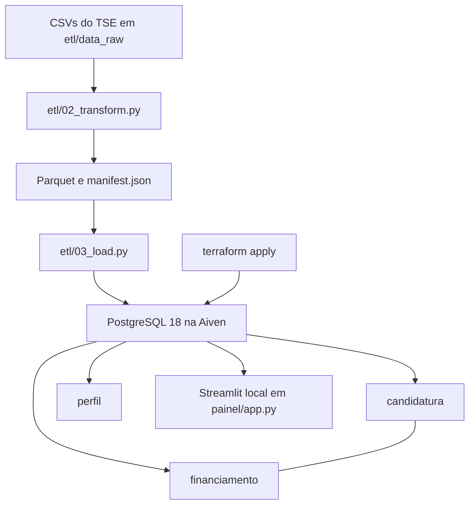

# Documento do projeto — Representatividade Política e Financiamento Eleitoral

Registro do trabalho da disciplina de Big Data e Analytics. Este arquivo junta o que foi pedido, o que o repositório já entrega e o que ainda falta para fechar o guia. O [README.md](../README.md) continua sendo o guia de execução. Decisões de privacidade estão em [LGPD.md](LGPD.md). O dicionário operacional do tratamento está em [TRATAMENTO.md](TRATAMENTO.md).

Nenhum token, senha ou URI de banco aparece aqui.

## 1. Identidade do trabalho

A disciplina pede um pipeline de engenharia, governança e análise de Big Data em nuvem, no plano gratuito, sobre base pública brasileira alinhada à ODS 5 (igualdade de gênero) e à ODS 18, no enunciado do guia (igualdade étnico-racial). O formato é grupo de até quatro integrantes.

O tema escolhido é **Representatividade Política e Financiamento Eleitoral**. A base oficial é o Portal de Dados Abertos do TSE, no recorte de candidaturas e prestação de contas das eleições municipais de 2024.

A pergunta do trabalho compara quem se candidata (gênero, raça, cargo, partido e UF) com o dinheiro declarado na prestação de contas. O valor analítico está nessa diferença: a fatia das candidaturas de um grupo e a fatia do recurso que esse grupo declara.

O repositório oficial é [https://github.com/JPedro-Santana/Big-Data-TSE].

## 2. O que foi pedido

As fontes abaixo não são a mesma entrega. O guia descreve o ciclo inteiro. A etapa de ingestão, a fase 2 e a continuação da AI 03 detalham marcos intermediários. O que já está pronto cobre sobretudo o Marco 2 e uma parte do Marco 3.

### 2.1 Guia da disciplina

O guia obriga seis etapas, nesta ordem:

1. Entendimento do negócio, escopo e LGPD.
2. Ingestão e classificação dos dados.
3. Limpeza e tratamento (ETL).
4. Modelagem e armazenamento.
5. Estudo de regras de negócio e métricas interseccionais.
6. Visualização dinâmica e interativa.

A arquitetura prevista no guia combina fontes abertas (CSV, JSON, Parquet ou API), ETL em Python, PySpark ou GitHub Actions, banco relacional na Aiven (PostgreSQL ou MySQL, plano gratuito de 1 GB) e, de forma opcional, OpenSearch para dado semi-estruturado. A visualização prevista é Streamlit Cloud, Grafana Cloud ou Metabase, com drill-down, filtros cruzados e troca de eixos.

Infraestrutura como código:

- Terraform com o provider da Aiven.
- Arquivos `main.tf`, `variables.tf` e `outputs.tf`.
- Credenciais fora do repositório público, em `.env` local e em secrets da plataforma de deploy.
- Remoção de dado pessoal identificável antes do armazenamento.

Pastas mínimas do repositório: `/etl`, `/terraform`, `/dashboard`, mais um `README.md` com diagrama da arquitetura, análise dos 5 V's, classificação dos tipos de dado, dicionário, regras de negócio, justificativa do banco e instruções de reprodução.

O dashboard pedido precisa de:

- no mínimo quatro métricas analíticas (KPIs) ligadas ao problema interseccional;
- filtros dinâmicos cruzados de ano, estado ou região, sexo, raça ou cor e faixa etária;
- seletor que troque a métrica do gráfico;
- drill-down ou detalhamento por segmento;
- painel publicado (Streamlit Cloud, Render, Vercel ou Grafana Cloud).

A entrega final inclui repositório Git, link do dashboard ativo e apresentação técnica de dez minutos (Terraform, arquitetura, regras de negócio e consultas ao vivo no painel).

Barema do guia, em 10 pontos:

- Arquitetura e engenharia em nuvem (Aiven e IaC): 2,5.
- Pipeline, tratamento e modelagem: 2,5.
- Regras de negócio, 5 V's, tipos de dado e LGPD: 1,5.
- Relevância analítica (ODS 5 e 18, cruzamento gênero e raça): 1,5.
- Dashboard dinâmico e interatividade: 1,0.
- Documentação e apresentação: 1,0.

Cronograma do guia:

- Marco 1 (semana 2): tema, download de amostras, estudo inicial dos 5 V's e da LGPD, conta na Aiven.
- Marco 2 (semana 4): Terraform e ETL com carga inicial no PostgreSQL.
- Marco 3 (semana 6): visualização ligada ao banco, com filtros e fluxos dinâmicos.
- Entrega final (semana 8): repositório, link do dashboard e apresentação.

### 2.2 Etapa de ingestão (texto de parâmetros e tipagem)

O levantamento da camada de ingestão, redigido para o projeto, fixou o seguinte:

- Origem: microdados do TSE das eleições municipais de 2024, em CSV, por download em lote. A ingestão não consome API em tempo real.
- Leitura: separador `;` e encoding `latin-1`.
- Três bases: consulta de candidatos, receitas de candidatos e despesas contratadas.
- Chave de integração: `SQ_CANDIDATO`.
- Despesas pagas ficam de fora do cruzamento direto, porque a chave dessa base é `SQ_PRESTADOR_CONTAS`.
- Estratégia para o disco de 1 GB do PostgreSQL gratuito: só o ciclo de 2024, processamento por UF, seleção de colunas, soma financeira por candidato, agregação analítica por UF × gênero × raça × cargo, e Parquet como formato intermediário. O banco recebe as tabelas analíticas, não os CSVs brutos.
- Amostragem só em teste de script. A carga final processa a totalidade de 2024.
- Sentinelas do TSE (`#NULO`, `#NULO#`, `#NE`, `-4`, `-1`) viram nulo real.
- `SQ_CANDIDATO` sai como inteiro. UF sai com dois caracteres. Cargo, gênero, raça e situação do turno saem como texto categórico. Receita e despesa contratada saem como numérico de precisão decimal fixa, depois da conversão do formato brasileiro e da soma por candidato.
- CPF, e-mail, data de nascimento, título eleitoral e identificadores de doador ou fornecedor saem na ingestão.

Fluxo descrito nessa etapa: CSV, leitura, remoção LGPD, nulos, conversão de tipos, agregação por candidato e por UF × gênero × raça × cargo, Parquet, PostgreSQL na Aiven.

### 2.3 Fase 2 — unificação, tratamento, modelagem e armazenamento

O PDF da fase 2 pede três entregas, com liberdade de ferramenta desde que a escolha seja justificável e documentada.

1. **Base tratada.** Dá para verificar origem, versão original, versão resultante, decisões e justificativas.
2. **Processo de tratamento.** Código no repositório, compreensível, com as decisões técnicas justificadas.
3. **Base no banco em nuvem.** Estrutura, tabelas, campos e tipos, relacionamentos e quantidade de dados armazenados.

### 2.4 Continuação da AI 03

Os itens seguintes fecham o marco de infraestrutura e repositório:

4. Infraestrutura em Terraform, com a organização de arquivos a critério da equipe.
5. Segurança: credenciais, senhas, tokens e chaves fora do repositório público, com a estratégia descrita na documentação.
6. Repositório Git identificável: código de tratamento, infraestrutura, documentação e o que for preciso para reproduzir a solução.
7. `README.md` com dados utilizados, tratamento, modelagem, infraestrutura e execução.
8. Liberdade tecnológica, compatível com a base e justificada.
9. Resultado do Marco 2: dado público, tratado, modelado, armazenado na nuvem, com processo e infraestrutura versionados, pronto para as fases seguintes.

A entrega listada nesse marco é: repositório Git, código de tratamento, base tratada, banco carregado, Terraform e README com as decisões.

## 3. O que está feito

### 3.1 Negócio e LGPD

O problema está definido: representatividade (quem concorre) contra financiamento (quanto cada candidatura declara). O alinhamento com as ODS do guia está no cruzamento de gênero e raça com o recurso de campanha.

A decisão de privacidade está implementada, não só descrita. [etl/lgpd_columns.py](../etl/lgpd_columns.py) remove, quando a coluna existe:

- `NR_CPF_CANDIDATO`, `NR_CPF_VICE_CANDIDATO`, `NR_TITULO_ELEITORAL_CANDIDATO`
- `DS_EMAIL`, `DT_NASCIMENTO`
- `NR_CPF_CNPJ_DOADOR`, `NM_DOADOR`, `NM_DOADOR_RFB`
- `NR_CPF_CNPJ_FORNECEDOR`, `NM_FORNECEDOR`, `NM_FORNECEDOR_RFB`
- `NR_CNPJ_PRESTADOR_CONTA`

Receitas e despesas são lidas só com a chave e o valor. O nome de urna (`NM_URNA_CANDIDATO`) permanece: é o nome público da campanha. A data de nascimento é usada para calcular a idade e em seguida descartada. O detalhe está em [LGPD.md](LGPD.md).

No manifesto da base tratada, as colunas pessoais efetivamente encontradas e removidas na candidatura foram `DS_EMAIL`, `DT_NASCIMENTO`, `NR_CPF_CANDIDATO` e `NR_TITULO_ELEITORAL_CANDIDATO`. Doador e fornecedor nem entram no DataFrame, porque a leitura da prestação de contas já restringe as colunas.

### 3.2 Ingestão e exploração

Os CSVs oficiais ficam em `etl/data_raw/` e não entram no Git. Na cópia local de trabalho, essa pasta ocupa cerca de 5,7 GB. O tratado ocupa cerca de 14 MB.

Arquivos usados pelo ETL:

- `consulta_cand_2024/consulta_cand_2024_{UF}.csv`
- `prestacao_de_contas_eleitorais_candidatos_2024/receitas_candidatos_2024_{UF}.csv`
- `prestacao_de_contas_eleitorais_candidatos_2024/despesas_contratadas_candidatos_2024_{UF}.csv`

O contrato de nomes, tipos e caminhos está em [etl/modelo.py](../etl/modelo.py): separador `;`, encoding `latin-1`, chave `SQ_CANDIDATO`.

Scripts de exploração, anteriores ao ETL final. Eles não gravam a base tratada:

- [etl/inspect_sample.py](../etl/inspect_sample.py) confere `DS_GENERO`, `DS_COR_RACA`, `DS_CARGO` e `SQ_CANDIDATO`.
- [etl/validar_merge.py](../etl/validar_merge.py) testa a chave entre candidatos e prestação de contas na mesma UF. Na amostra de AC usada nessa checagem, cerca de 80% dos candidatos tinham correspondência em receitas e cerca de 57% em despesas contratadas. O resultado nacional, depois do ETL completo, está na seção 3.4.
- [etl/01_explore.py](../etl/01_explore.py) mostra estrutura, primeiras linhas e contagem de gênero, raça e cargo.

`despesas_pagas` não entra. A chave dessa base é `SQ_PRESTADOR_CONTAS`, e o join direto com a candidatura não fecha. Os arquivos de despesa paga também não estão na pasta local usada pelo pipeline.

### 3.3 Tratamento

O comando é `etl/02_transform.py`. A lógica está em [etl/transformar.py](../etl/transformar.py). Dá para rodar uma UF (`--uf AC`) ou todas as UFs encontradas em `data_raw`.

O que o script faz, na ordem em que a base exige:

- Lê `SQ_CANDIDATO` como texto e só depois converte para inteiro. Um float alteraria o identificador grande e o join falharia sem aviso.
- Mantém, para cada candidatura, o maior `NR_TURNO`. Prefeito de segundo turno aparece mais de uma vez em `consulta_cand`. O resultado final da campanha está no último turno.
- Soma `VR_RECEITA` e `VR_DESPESA_CONTRATADA` por candidato, em blocos de 200 mil linhas. Aceita vírgula decimal, arredonda em centavos e guarda a quantidade de lançamentos em `qt_receitas` e `qt_despesas`.
- Parte da candidatura (left join) e preenche ausência de dinheiro com zero. Quem não arrecadou continua na base. Sem isso, a comparação entre percentual de candidaturas e percentual do recurso fica distorcida.
- Lançamento financeiro sem candidatura naquela UF não entra na tabela. A contagem vai para o manifesto (`receitas_sem_candidato`, `despesas_sem_candidato`).
- Sentinelas de texto `#NULO#`, `#NULO`, `#NE#`, `#NE`, `-1`, `-3` e `-4` viram nulo. Nas numéricas, `-1`, `-3` e `-4` também. Idade negativa ou acima de 120 vira nulo. Ausência não vira zero.
- Gênero, raça, cargo, sigla de partido, UF e situação do turno vão para maiúsculas, para o mesmo rótulo não se partir em dois.
- O layout de 2024 de `consulta_cand` não traz `NR_IDADE_DATA_POSSE`. A idade é calculada em 1º de janeiro do ano seguinte à eleição, a partir de `DT_NASCIMENTO`, e só o número é gravado. Idade acima de 120, vinda de data inválida na fonte, vira nulo.

A ferramenta é Pandas em blocos, não um cluster PySpark. Depois da agregação por UF o grão é uma linha por candidatura. O processamento em lote exigido pela disciplina está na leitura em chunks e no laço por UF.

A saída, fora do Git, é:

- `etl/data_processed/candidatura.parquet`
- `etl/data_processed/financiamento.parquet`
- `etl/data_processed/manifest.json`

Quem clona o repositório regenera essa base rodando o tratamento sobre os CSVs.

### 3.4 Resultado da base tratada

Números do `manifest.json` da cópia local, pleito de 2024, grão de uma linha por `SQ_CANDIDATO`:

- 463.677 linhas em candidatura e o mesmo número em financiamento.
- 26 estados. O Distrito Federal não entra: o pleito de 2024 é municipal e o DF não tem municípios. O arquivo `consulta_cand_2024_BRASIL.csv`, quando presente, também fica de fora, porque o descobridor de UF espera sigla de duas letras.
- 0 `sq_candidato` repetido entre UFs.
- 85.401 candidaturas sem receita (preenchidas com zero).
- 177.893 candidaturas sem despesa contratada (preenchidas com zero).

UFs processadas: AC, AL, AM, AP, BA, CE, ES, GO, MA, MG, MS, MT, PA, PB, PE, PI, PR, RJ, RN, RO, RR, RS, SC, SE, SP e TO.

### 3.5 Estudos e conferências

Dois testes acompanham o pipeline, além da exploração da seção 3.2.

[etl/verificar_fixture.py](../etl/verificar_fixture.py) roda o tratamento sobre CSVs sintéticos no formato do TSE, em `etl/fixtures/`, só com a UF AC. Não são os microdados oficiais. O teste exige:

- três candidaturas, identificadores 1001, 1002 e 1003;
- a candidatura 1001 preservada no turno 2, com situação `ELEITO`, nome de urna `URNA UM`, receita 30,50 (dois lançamentos somados) e despesa contratada 3,00;
- a candidatura 1002 com gênero `FEMININO`, raça `PARDA`, receita zero e idade nula no caso sintético;
- a candidatura 1003 com receita 5,00 e despesa 7,50;
- um lançamento de receita sem candidato na UF, contado no manifesto e ausente da base;
- nenhuma coluna da lista de LGPD no parquet de saída.

[etl/validar_carga.py](../etl/validar_carga.py) confere o PostgreSQL depois da carga, com o serviço da Aiven em Running. Ele exige as três tabelas (`candidatura`, `financiamento`, `perfil`), a mesma quantidade de linhas nas duas tabelas de grão, nenhum financiamento órfão, nenhuma idade acima de 120 ou negativa, e a soma de receita e de despesa da tabela `perfil` igual à soma de `financiamento`.

### 3.6 Modelagem e carga

O banco é relacional. O grão é tabular, a chave é estável e a análise cruza atributos da candidatura com totais. Um banco documental não acrescenta nada a esse grão. OpenSearch, previsto como opcional no guia, não foi provisionado: não há busca textual nem log semi-estruturado nesta entrega.

Não há tabela de lançamento. Cada doação estouraria o disco de 1 GB e guardaria dado pessoal de doador e fornecedor. A pergunta desta etapa é quanto cada candidatura movimentou.

A carga está em [etl/carregar.py](../etl/carregar.py), chamada por `etl/03_load.py`. Ela apaga e recria as tabelas, então rodar de novo substitui os dados. Os inserts vão em blocos de 2.000 linhas. A URI vem de `DATABASE_URL` no `.env` da raiz.

`candidatura` (uma linha por candidatura, chave `sq_candidato`):

- `sq_candidato` — `BIGINT`, chave primária, origem `SQ_CANDIDATO`
- `ano_eleicao` — `INTEGER`, origem `ANO_ELEICAO`
- `sg_uf` — `CHAR(2)`, origem `SG_UF`
- `nm_ue` — `TEXT`, município, origem `NM_UE`
- `ds_cargo` — `TEXT`, origem `DS_CARGO`
- `nm_urna` — `TEXT`, origem `NM_URNA_CANDIDATO`
- `sg_partido` — `TEXT`, origem `SG_PARTIDO`
- `nm_partido` — `TEXT`, origem `NM_PARTIDO`
- `ds_genero` — `TEXT`, origem `DS_GENERO`
- `ds_cor_raca` — `TEXT`, origem `DS_COR_RACA`
- `ds_sit_tot_turno` — `TEXT`, origem `DS_SIT_TOT_TURNO`
- `nr_turno_resultado` — `SMALLINT`, maior `NR_TURNO` mantido
- `nr_idade_data_posse` — `SMALLINT`, idade calculada; a data de nascimento não é armazenada

`financiamento` (mesma quantidade de linhas, relacionamento 1 para 1):

- `sq_candidato` — `BIGINT`, chave primária e chave estrangeira para `candidatura`
- `vr_receita` — `NUMERIC(16,2)`, soma de `VR_RECEITA`
- `vr_despesa_contratada` — `NUMERIC(16,2)`, soma de `VR_DESPESA_CONTRATADA`
- `qt_receitas` — `INTEGER`, quantidade de lançamentos de receita
- `qt_despesas` — `INTEGER`, quantidade de lançamentos de despesa contratada

`perfil` é a agregação pedida na etapa de ingestão. Ela é criada na carga, a partir do join das duas tabelas, no grão UF × gênero × raça × cargo:

- `sg_uf`, `ds_genero`, `ds_cor_raca`, `ds_cargo`
- `qt_candidaturas`
- `vr_receita`, `vr_despesa_contratada`

Há um índice em `candidatura (sg_uf, ds_cargo, ds_genero, ds_cor_raca)` para essa leitura. O painel atual consulta `candidatura` e `financiamento` direto e agrega na hora. A tabela `perfil` existe para a análise nesse grão e para a conferência de [validar_carga.py](../etl/validar_carga.py).

A situação da candidatura não está em `etl/modelo.py`, no Parquet nem no `CREATE TABLE` de `etl/carregar.py`. O README e o TRATAMENTO.md registram isso como limitação. O filtro de aptos exige reprocessar a base.

### 3.7 Infraestrutura e segurança

O Terraform está em `terraform/`: `main.tf`, `variables.tf`, `outputs.tf`, mais `terraform.tfvars.example`. O provider é `aiven/aiven` 4.x. O Terraform exigido é 1.5 ou superior.

O recurso é um único serviço `aiven_pg.tse`:

- projeto `cauamaia488-ead4`
- serviço `pg-1f18e561`
- plano `free-1-1gb`: 1 CPU, 1 GB de RAM, 1 GB de disco, até 20 conexões
- PostgreSQL 18
- região `do-sfo` (DigitalOcean, São Francisco), a que a Aiven atribuiu no plano gratuito e que o Terraform registra
- acesso público com SSL
- filtro de IP aberto (`0.0.0.0/0` e `::/0`), porque o plano e o uso acadêmico precisam alcançar a máquina de quem carrega e de quem abre o painel

A URI de saída do Terraform é `sensitive`. O token é a variável `aiven_api_token`, também `sensitive`.

Onde cada segredo fica:

- Token da Aiven: `terraform/terraform.tfvars`, só na máquina de quem aplica. O Git leva `terraform.tfvars.example`, com texto de exemplo.
- URI do PostgreSQL: `.env`, variável `DATABASE_URL`. O Git leva `.env.example`, com senha e host fictícios.
- Estado do Terraform: `.terraform/` e `*.tfstate` na máquina local. O state guarda a senha do banco e não entra no Git.

O `.gitignore` bloqueia `etl/data_raw/`, o conteúdo de `etl/data_processed/` (exceto o `.gitkeep`), `.env`, `*.tfvars`, `.terraform/`, `*.tfstate` e `venv/`.

### 3.8 Regras de negócio já aplicadas

Estas regras transformam o microdado em indicador. Elas estão no código de tratamento, na carga ou no painel.

1. **Grão da candidatura.** Uma linha por `SQ_CANDIDATO`. O dinheiro já está somado.
2. **Resultado do último turno.** Havendo duas linhas da mesma candidatura, permanece a de maior `NR_TURNO`.
3. **Dinheiro declarado.** `vr_receita` é a soma de `VR_RECEITA`. `vr_despesa_contratada` é a soma de `VR_DESPESA_CONTRATADA`. A precisão é de centavos (`NUMERIC(16,2)`).
4. **Quem não movimentou permanece.** Ausência de lançamento vira zero na candidatura. A comparação de percentuais usa o universo de quem concorreu.
5. **Órfão financeiro.** Lançamento sem candidatura na UF não entra na tabela analítica. A contagem fica no manifesto.
6. **Sentinela não é categoria.** Códigos de ausência do TSE viram nulo. Idade impossível também.
7. **Rótulo único.** Categorias de perfil saem em maiúsculas.
8. **Minimização.** Dado pessoal identificável sai antes do Parquet e antes da nuvem. A chave analítica é `SQ_CANDIDATO`, não o CPF.
9. **Idade sem data.** A idade na posse substitui a data de nascimento. O limite superior gravado é 120 anos.
10. **Indicador do painel.** Para cada grupo, a fatia de candidaturas é a quantidade do grupo dividida pelo total do recorte. A fatia do dinheiro é o valor do grupo dividido pelo total do recorte. A diferença, em pontos percentuais, é a fatia do dinheiro menos a fatia das candidaturas. Diferença negativa: o grupo concorre em proporção maior do que a do recurso que declara.
11. **Leitura da chapa.** No recorte de todos os cargos, o painel registra que vice-prefeito aparece com quase nenhum dinheiro, porque a prestação da chapa costuma ser lançada no candidato a prefeito. Isso é aviso de leitura, não um filtro que apaga o vice.

A regra "guardar situação da candidatura e filtrar aptos só na análise", escrita na fase 2, não foi implementada. A documentação foi alinhada ao código e a ausência aparece como limitação. Ver a seção 5.

### 3.9 Painel

O app está em [painel/app.py](../painel/app.py). Sobe com:

```powershell
.\venv\Scripts\python.exe -m streamlit run painel\app.py
```

Abre em `http://localhost:8501`. Lê `candidatura` e `financiamento` no PostgreSQL da Aiven. O cache da consulta dura cinco minutos.

O que a tela faz hoje:

- Três métricas no topo: quantidade de candidaturas, total do dinheiro escolhido e quantidade de UFs no recorte.
- Seletor de cargo: Todos, Vereador, Prefeito ou Vice-prefeito.
- Seletor de dinheiro: Receita ou Despesa contratada. O gráfico troca a série laranja conforme essa escolha.
- Gráficos de gênero e de raça, com duas séries: percentual de candidaturas e percentual do dinheiro.
- Com o cargo em “Todos”, um terceiro gráfico por cargo.
- Tabelas com quantidade, valor em reais, os dois percentuais e a diferença em pontos percentuais.
- Mensagem quando o serviço da Aiven não responde ou quando o `.env` não está na raiz.

A pasta `dashboard/`, exigida no guia como nome de diretório, contém apenas o placeholder. O código do painel está em `painel/`.

### 3.10 Dependências e reprodução

Python 3, com o que está em `requirements.txt`: Pandas 3.0.5, PyArrow 18 ou superior, SQLAlchemy 2 ou superior, psycopg 3.2 ou superior, python-dotenv e Streamlit 1.66.1. O gráfico usa Altair, trazido pelo Streamlit. Terraform 1.5 ou superior. Conta na Aiven com projeto e token pessoal.

A sequência completa (ambiente, fixture, tratamento, `terraform init/plan/apply`, `.env` e carga) está no [README.md](../README.md). Este documento não repete os comandos para não divergir do guia de execução.

### 3.11 Os 5 V's neste dataset

- **Volume.** Os CSVs brutos locais passam de vários gigabytes (cerca de 5,7 GB na cópia de trabalho) e não cabem no disco de 1 GB do plano gratuito. O ETL reduz isso a 463.677 linhas por tabela e a cerca de 14 MB de Parquet, por soma financeira, corte de colunas e compressão colunar. A carga no banco é só dessa base.
- **Variedade.** Há três estruturas tabulares com grãos diferentes: cadastro da candidatura (uma ou duas linhas por pessoa, por causa do segundo turno), receitas (vários lançamentos) e despesas contratadas (vários lançamentos). O valor monetário chega como texto no padrão brasileiro. O `manifest.json` é o artefato semi-estruturado do pipeline. Os PDFs de leiaute do TSE, quando presentes em `data_raw`, são material não estruturado de referência e não entram na carga.
- **Velocidade.** O fluxo é lote (batch), por download dos arquivos do pleito, não API contínua. A leitura da prestação de contas anda em blocos de 200 mil linhas, UF por UF. Não há GitHub Actions agendando nova ingestão.
- **Veracidade.** A chave não passa por float. O segundo turno não duplica a candidatura. Sentinelas do TSE não viram categoria. Dinheiro usa decimal de centavos. A fixture sintética e `validar_carga.py` conferem grão, LGPD, idade e o fechamento entre `perfil` e `financiamento`.
- **Valor.** O indicador compara a composição de quem concorre com a composição do recurso, por gênero e por raça, no pleito municipal de 2024. É a leitura de equidade pedida pelas ODS do guia, aplicada a representação política e a dinheiro de campanha.

### 3.12 Tipos de dado

- **Estruturados:** CSVs do TSE, Parquet de candidatura e de financiamento, tabelas PostgreSQL `candidatura`, `financiamento` e `perfil`.
- **Semi-estruturados:** `manifest.json` (contagens por UF, colunas, avisos de LGPD). Não há resposta de API em JSON neste pipeline.
- **Não estruturados:** PDFs de leiaute publicados junto com os microdados, usados como documentação da fonte. O pipeline não extrai texto desses PDFs.

## 4. Arquitetura que está no ar



`candidatura` e `financiamento` se ligam 1 para 1 por `sq_candidato`. `perfil` é o agregado UF × gênero × raça × cargo, recalculado a cada carga. O painel local lê as duas tabelas de grão. O Terraform cria o serviço. A carga só acontece depois que o serviço está em Running e o `.env` aponta para ele.

## 5. O que ainda não fecha o guia

Itens abaixo são pendência explícita. Parte deles é fase seguinte do próprio guia. Parte é divergência entre o texto já escrito e o código.

- **Situação da candidatura.** O código não grava essa coluna, e a documentação agora diz isso. O painel conta todas as candidaturas registradas. "Apenas aptos" exige reprocessar a base.
- **Pasta do dashboard.** Resolvido. O código do painel está em `dashboard/painel/app.py` e o painel está publicado no Streamlit Community Cloud: https://big-data-tse-trabalho.streamlit.app/. O passo a passo da publicação está na seção Painel do README.
- **Interatividade pedida no guia.** Resolvido. O painel tem filtros cruzados de região, UF, gênero, raça/cor e faixa etária (o ano fica fixo em 2024, único pleito da base), seletor de cargo, seletor de dinheiro (receita ou despesa), seletor de métrica (Total, % e Média), mapa gênero × raça, drill-down do estado para o município e quatro KPIs no topo. A descrição completa está na seção Painel do README.
- **Textos defasados.** O README foi atualizado e agora descreve o painel publicado, o modelo estrela em views, os 5 V's com os três tipos de dado, o tamanho medido do banco e as justificativas de LGPD e de acesso ao banco.
- **Fora do desenho, de propósito.** Não há OpenSearch, não há GitHub Actions e não há série histórica. `despesas_pagas` continua de fora por causa de `SQ_PRESTADOR_CONTAS`. Essas ausências são decisão de escopo, não esquecimento de arquivo.
- **Entrega final do guia.** O link público do painel está no README e neste documento. O roteiro do pitch de dez minutos está em [ROTEIRO_APRESENTACAO.md](ROTEIRO_APRESENTACAO.md). O README reúne os seis itens pedidos pelo guia (diagrama, 5 V's, tipos de dado, dicionário e regras de negócio, justificativa do banco e guia de reprodução).

## 6. Como ler os outros arquivos

- [README.md](../README.md): como reproduzir tratamento, Terraform, carga e painel.
- [TRATAMENTO.md](TRATAMENTO.md): dicionário da fase 2, alinhado ao código. A situação da candidatura aparece como fora da base.
- [LGPD.md](LGPD.md): lista de colunas pessoais e o que permanece.
