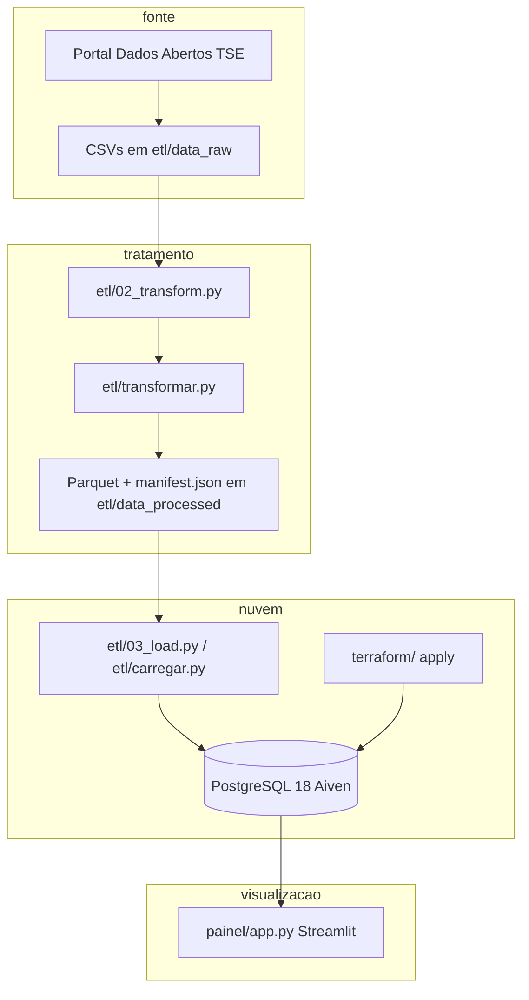

# Estudo do projeto — Representatividade Política e Financiamento Eleitoral

Material para a prova de Big Data. Tudo abaixo foi baseado **somente** no que existe no repositório. Onde citamos caminho de arquivo. Dedutivos estão marcados com **(inferido)**. Sem senhas, tokens ou hosts reais.

Referências úteis: [README.md](../README.md), [DOCUMENTO_DO_PROJETO.md](DOCUMENTO_DO_PROJETO.md), [TRATAMENTO.md](TRATAMENTO.md), [LGPD.md](LGPD.md).

---

## 1. Visão geral

| Item | Conteúdo |
|------|----------|
| **Tema** | Representatividade política e financiamento eleitoral nas eleições municipais de 2024 |
| **Fonte** | Portal de Dados Abertos do TSE |
| **Objetivo** | Comparar quem se candidata (gênero, raça, cargo, partido, UF) com quanto cada candidatura declara em receitas e despesas contratadas |
| **ODS (guia da disciplina)** | Cruzamento gênero e raça com recurso de campanha — ver [DOCUMENTO_DO_PROJETO.md](DOCUMENTO_DO_PROJETO.md) §1 |

### Fluxo ponta a ponta



**Por que esse fluxo:** os CSVs brutos são muito grandes para o disco de 1 GB do PostgreSQL gratuito. Nós tratamos e agregamos em Parquet local e só então carregamos tabelas analíticas no banco (`README.md`, `etl/transformar.py`, `etl/carregar.py`).

---

## 2. Fonte de dados

| Aspecto | Detalhe | Onde no repositório |
|---------|---------|---------------------|
| Origem | Portal de Dados Abertos do TSE | `README.md` |
| Pleito | Eleições municipais **2024** | `README.md`, `etl/modelo.py` |
| Formato | CSV, separador `;`, encoding `latin-1` | `etl/modelo.py` (`READ_OPTS`) |
| Ingestão | Download em lote de arquivos CSV; **API em tempo real não encontrada no repositório** | `docs/DOCUMENTO_DO_PROJETO.md` §2.2 |
| Bases usadas no ETL | `consulta_cand_2024`, `receitas_candidatos_2024`, `despesas_contratadas_candidatos_2024` | `etl/modelo.py`, `manifest.json` |
| Caminhos esperados | `etl/data_raw/consulta_cand_2024/consulta_cand_2024_{UF}.csv`; `etl/data_raw/prestacao_de_contas_eleitorais_candidatos_2024/receitas_candidatos_2024_{UF}.csv`; `.../despesas_contratadas_candidatos_2024_{UF}.csv` | `README.md`, `etl/modelo.py` |
| Identificação da base | Microdados oficiais TSE — eleições 2024 | `etl/data_processed/manifest.json` (`origem`) |
| Recorte geográfico | 26 UFs listadas no manifest (AC, AL, …, TO) | `etl/data_processed/manifest.json` (`ufs`) |
| Fora do recorte | DF não aparece (pleito municipal sem municípios no DF); arquivo `consulta_cand_2024_BRASIL.csv` não entra se a sigla não tiver 2 letras | `docs/DOCUMENTO_DO_PROJETO.md` §3.4, `etl/transformar.py` (`descobrir_ufs`) |
| Chave de integração | `SQ_CANDIDATO` | `etl/modelo.py` (`CHAVE`) |
| Base excluída | `despesas_pagas` — chave `SQ_PRESTADOR_CONTAS` | `docs/TRATAMENTO.md`, `manifest.json` (`fora_do_cruzamento`) |
| Tamanho original (local) | Cerca de **5,7 GB** em `etl/data_raw/` na cópia de trabalho documentada | `docs/DOCUMENTO_DO_PROJETO.md` §3.2 (pasta gitignorada) |
| Notebooks Jupyter | **não encontrado no repositório** | — |

**Características que mudaram o desenho** (`README.md`):

- Várias linhas por candidatura na prestação de contas.
- Prefeito pode aparecer duas vezes (segundo turno).
- Valores monetários em padrão brasileiro (vírgula decimal).
- Marcadores de ausência do TSE: `#NULO`, `#NE`, `-4`, etc. (`etl/modelo.py`).

---

## 3. Estratégia de volume (limite 1 GB — Aiven Free Tier)

Plano documentado: `free-1-1gb` (1 CPU, 1 GB RAM, 1 GB disco) — `terraform/variables.tf`, `terraform/main.tf`.

| Estratégia | O que fizemos | Motivo |
|------------|---------------|--------|
| Recorte temporal | Apenas pleito **2024** | Uma eleição já responde à pergunta do trabalho |
| Recorte de bases | Só 3 CSVs por UF (candidatos + receitas + despesas contratadas) | Foco na pergunta representatividade × dinheiro |
| Seleção de colunas | Candidatos: colunas em `etl/modelo.py`; contas: só chave + valor na leitura | Menos volume e menos LGPD (`etl/transformar.py` `usecols`) |
| Agregação prévia | Soma `VR_RECEITA` e `VR_DESPESA_CONTRATADA` por candidato; **não** guardamos cada lançamento | Microdado não cabe em 1 GB; doador/fornecedor seriam PII |
| Processamento | UF por UF; chunks de **200.000** linhas na prestação | Memória e lote (`etl/transformar.py`, `CHUNK`) |
| Formato intermediário | Parquet em `etl/data_processed/` | Compressão colunar (`requirements.txt`: pyarrow) |
| Tabela agregada no banco | `perfil` (UF × gênero × raça × cargo) | Consultas sem repetir 463 mil linhas (`etl/carregar.py`) |
| Amostragem | Parâmetro `--nrows` só para teste; `0` = arquivo inteiro | `etl/transformar.py` |
| Estimativa de tamanho | Contagens no `manifest.json`; após carga, `pg_size_pretty` em `etl/carregar.py` e `etl/validar_carga.py` | Provar que coube no plano |

**Não usamos** amostragem aleatória na carga final — processamos a totalidade de 2024 por UF (`docs/DOCUMENTO_DO_PROJETO.md` §2.2).

### Quanto ficou no final

| Métrica | Valor | Fonte |
|---------|-------|-------|
| Linhas `candidatura` / `financiamento` | **463.677** cada | `etl/data_processed/manifest.json` |
| Parquet tratado (local) | Cerca de **14 MB** | `docs/DOCUMENTO_DO_PROJETO.md` §3.2 |
| Candidatos sem receita (zero após join) | 85.401 | `manifest.json` |
| Candidatos sem despesa contratada | 177.893 | `manifest.json` |
| Tamanho exato do PostgreSQL após carga | Impresso ao rodar carga/validação; **valor fixo não versionado no Git** | `etl/carregar.py` (`imprimir_volume`) |

**Antes da agregação (exemplo):** no manifest, AC tem 2.311 linhas brutas de candidatos, 6.313 de receitas e 23.511 de despesas contratadas — milhões de linhas de lançamento no país inteiro, reduzidas a 463.677 candidaturas.

Soma das `linhas_candidatos_brutas` por UF no manifest ≈ **464.081**; linhas de turno removidas no total ≈ **204** (campo `linhas_turno_removidas` por UF).

---

## 4. Tipagem e conversão de dados

Contrato: `etl/modelo.py`. Lógica: `etl/transformar.py`. Tipos no banco: `etl/carregar.py`.

| Coluna | Tipo original (CSV) | Tipo final (Parquet / PG) | Transformação | Motivo |
|--------|---------------------|---------------------------|---------------|--------|
| `SQ_CANDIDATO` → `sq_candidato` | texto (lido como `string`) | `Int64` / `BIGINT` PK | `normalizar_chave` | Evitar float na chave e join errado |
| `ANO_ELEICAO` → `ano_eleicao` | texto ou número | `INTEGER` | `para_numero` | Ano consistente |
| `SG_UF` → `sg_uf` | texto | `CHAR(2)` | limpar sentinelas + maiúsculas | UF padronizada |
| `NM_UE` → `nm_ue` | texto | `TEXT` | `limpar_texto` | Município |
| `DS_CARGO`, partidos, gênero, raça, situação turno | texto | `TEXT` | maiúsculas em categorias | Mesmo rótulo, uma categoria |
| `NR_TURNO` → `nr_turno_resultado` | texto/número | `SMALLINT` | maior turno por candidato | Resultado final da campanha |
| `DT_NASCIMENTO` | data texto | **não armazenada** | vira `nr_idade_data_posse` e coluna removida (LGPD) | Idade sem guardar data |
| `NR_IDADE_DATA_POSSE` / idade calculada | texto/número | `SMALLINT` | `idade_na_posse` + `limitar_idade` (0–120) | Layout 2024 muitas vezes sem coluna pronta |
| `VR_RECEITA` | texto BR ou número | `NUMERIC(16,2)` | vírgula→ponto, soma, `round(2)` | Centavos corretos |
| `VR_DESPESA_CONTRATADA` | idem | `NUMERIC(16,2)` | idem | idem |
| `qt_receitas`, `qt_despesas` | — (derivado) | `INTEGER` | contagem na agregação | Quantos lançamentos formaram o total |

**Atenção:** `docs/TRATAMENTO.md` e `README.md` citam `ds_situacao_candidatura`, mas essa coluna **não** está em `etl/modelo.py`, no Parquet (`manifest.json` `colunas_candidatura`) nem no `CREATE TABLE` de `etl/carregar.py`.

---

## 5. Tratamento

**Scripts da entrega:** `etl/02_transform.py` chama `etl/transformar.py`.  
**Exploração (não grava base final):** `etl/01_explore.py`, `etl/inspect_sample.py`, `etl/validar_merge.py`.

### Problemas encontrados e decisões

| Problema | Decisão | Arquivo |
|----------|---------|---------|
| Pandas pode promover `SQ_CANDIDATO` a float | Ler chave como `string`, depois inteiro | `etl/transformar.py` |
| Várias linhas por candidato nas contas | Agregar soma e contagem | `agregar_valor` |
| Candidato sem receita ou despesa | Left join + zero | `processar_uf` |
| Duplicata por segundo turno | Ordenar por turno, manter último | `preparar_candidatos` |
| Lançamento sem candidato na UF | Não entra; conta no manifest | `_contar_orfaos` |
| Sentinelas `#NULO`, `#NE`, `-1`, `-3`, `-4` | Nulo real (texto e numérico) | `etl/modelo.py`, `limpar_texto`, `para_numero` |
| Categorias em caixas diferentes | Maiúsculas em gênero, raça, cargo, etc. | `COLUNAS_CATEGORIA_MAIUSCULA` |
| CPF, e-mail, nascimento, doador | Remover antes de gravar | `etl/lgpd_columns.py`, `docs/LGPD.md` |
| Encoding / separador errado | Sempre `latin-1` e `;` | `etl/modelo.py` |

### Ordem das transformações (por UF)

1. Ler e preparar candidatos: LGPD, limpeza, idade, dedup turno.  
2. Agregar receitas e despesas em chunks.  
3. Unir receitas e despesas; left join com candidatos.  
4. Preencher ausência financeira com 0 e contadores com 0.  
5. Concatenar todas as UFs; remover `sq_candidato` repetido entre UFs, se existir.  
6. Gravar `candidatura.parquet`, `financiamento.parquet`, `manifest.json`.

### Linhas antes × depois (nacional)

| Estágio | Quantidade |
|---------|------------|
| Linhas brutas em `consulta_cand` (soma por UF) | ~464.081 |
| Linhas removidas por dedup de turno | 204 (total nas UFs no manifest) |
| **Grão final (uma linha por candidato)** | **463.677** |
| Linhas brutas receitas + despesas | Milhões (ver `por_uf` no manifest) |
| **Após agregação financeira** | **463.677** (1:1 com candidatura) |

**Teste automatizado:** `etl/verificar_fixture.py` usa CSVs em `etl/fixtures/` (sintéticos, formato TSE).

---

## 6. Modelagem

**Estilo:** relacional normalizado — duas entidades no grão candidatura com relacionamento **1:1**; `perfil` é agregado analítico (não é fato de lançamento).

**Por que não estrela com fato de lançamento:** volume, LGPD e limite de 1 GB (`README.md`, `docs/TRATAMENTO.md`).

### Entidades e campos

**`candidatura`** — PK `sq_candidato` (`etl/carregar.py`, `etl/modelo.py`):

- `sq_candidato` BIGINT PK  
- `ano_eleicao` INTEGER  
- `sg_uf` CHAR(2)  
- `nm_ue` TEXT  
- `ds_cargo` TEXT  
- `nm_urna` TEXT  
- `sg_partido`, `nm_partido` TEXT  
- `ds_genero`, `ds_cor_raca` TEXT  
- `ds_sit_tot_turno` TEXT  
- `nr_turno_resultado` SMALLINT  
- `nr_idade_data_posse` SMALLINT  

**`financiamento`** — PK/FK `sq_candidato`:

- `vr_receita`, `vr_despesa_contratada` NUMERIC(16,2)  
- `qt_receitas`, `qt_despesas` INTEGER  
- FK para `candidatura(sq_candidato)`

**`perfil`** — sem PK declarada; preenchida por `INSERT ... SELECT ... GROUP BY`:

- `sg_uf`, `ds_genero`, `ds_cor_raca`, `ds_cargo`  
- `qt_candidaturas`, `vr_receita`, `vr_despesa_contratada`

### Diagrama ER

```mermaid
erDiagram
  candidatura ||--|| financiamento : "sq_candidato"
  candidatura {
    bigint sq_candidato PK
    int ano_eleicao
    char sg_uf
    text ds_cargo
    text ds_genero
    text ds_cor_raca
    smallint nr_idade_data_posse
  }
  financiamento {
    bigint sq_candidato PK_FK
    numeric vr_receita
    numeric vr_despesa_contratada
    int qt_receitas
    int qt_despesas
  }
  perfil {
    char sg_uf
    text ds_genero
    text ds_cor_raca
    text ds_cargo
    int qt_candidaturas
    numeric vr_receita
    numeric vr_despesa_contratada
  }
```

Índice: `idx_candidatura_perfil` em `(sg_uf, ds_cargo, ds_genero, ds_cor_raca)` — `etl/carregar.py`.

---

## 7. Banco de dados

| Item | Detalhe |
|------|---------|
| Serviço | PostgreSQL na **Aiven** via Terraform (`aiven_pg.tse`) |
| Plano | `free-1-1gb`, PostgreSQL **18**, região `do-sfo` (default em `terraform/variables.tf`) |
| Registros por tabela | `candidatura`: 463.677; `financiamento`: 463.677; `perfil`: quantidade de grupos UF×gênero×raça×cargo **(não listada no manifest)** |
| Como a carga é feita | Lê Parquet; `DROP` + `CREATE` tabelas; `pandas.to_sql` em blocos de **2000**; recria `perfil` e índice | `etl/carregar.py` |
| CLI | `etl/03_load.py` |
| Conexão | `DATABASE_URL` em `.env` na raiz |
| Validação pós-carga | `etl/validar_carga.py` (tabelas, órfãos, idade, soma `perfil` = `financiamento`) |

**OpenSearch / MySQL:** não encontrado no repositório.

---

## 8. Infraestrutura com Terraform

| Arquivo | Função |
|---------|--------|
| `terraform/main.tf` | Versão Terraform ≥ 1.5; provider `aiven/aiven` 4.x; recurso `aiven_pg` "tse" com tags, `public_access`, `ip_filter`, `pg_version` |
| `terraform/variables.tf` | `aiven_api_token` (sensitive), `aiven_project_name`, `service_name`, `cloud_name`, `plan`, `pg_version`, `ip_filter` |
| `terraform/outputs.tf` | `postgresql_service_uri` (sensitive), host e porta |
| `terraform/terraform.tfvars.example` | Modelo para token e nomes (sem segredo real) |
| `terraform/.terraform.lock.hcl` | Lock de versões do provider |

**Recursos provisionados:** um único serviço PostgreSQL (`aiven_pg.tse`).

**Comandos** (`README.md`):

```powershell
copy terraform\terraform.tfvars.example terraform\terraform.tfvars
# Editar token localmente — não commitar

cd terraform
terraform init
terraform plan
terraform apply
terraform output -raw postgresql_service_uri
```

**Backend remoto para state:** não encontrado no repositório (state local, gitignorado).

---

## 9. Segurança

| Segredo | Onde fica | Versionado no Git? |
|---------|-----------|-------------------|
| Token Aiven | `terraform/terraform.tfvars` | Não (`*.tfvars` em `.gitignore`; só `*.tfvars.example`) |
| URI e senha do banco | `.env` → `DATABASE_URL` | Não (`.env` ignorado; `.env.example` com placeholders) |
| State Terraform | `.terraform/`, `*.tfstate` | Não — **state contém senha do banco** (comentário em `.gitignore`) |
| Dados brutos e parquet grande | `etl/data_raw/`, `etl/data_processed/*` | Não |

**Por que nada sensível vai para o repositório público:** minimização LGPD nos dados; credenciais só na máquina de quem roda; variáveis e outputs `sensitive` no Terraform (`terraform/variables.tf`, `terraform/outputs.tf`).

**Trade-off consciente:** `ip_filter` padrão `0.0.0.0/0` e `::/0` para facilitar carga e painel em ambiente acadêmico (`terraform/variables.tf`).

---

## 10. Como executar (do zero)

Ferramentas: Python 3, `requirements.txt` (pandas 3.0.5, pyarrow, sqlalchemy, psycopg, python-dotenv, streamlit), Terraform ≥ 1.5, conta Aiven.

1. `python -m venv venv` e `pip install -r requirements.txt`  
2. Colocar CSVs oficiais em `etl/data_raw/` (estrutura no `README.md`)  
3. (Opcional) `python etl/verificar_fixture.py`  
4. `python etl/02_transform.py` ou `python etl/02_transform.py --uf AC`  
5. Configurar `terraform/terraform.tfvars` e `terraform init` / `plan` / `apply`  
6. Copiar URI para `.env` como `DATABASE_URL`  
7. `python etl/03_load.py`  
8. (Opcional) `python etl/validar_carga.py`  
9. `python -m streamlit run painel/app.py` (porta 8501 — `.streamlit/config.toml`)

**Pasta `/dashboard` do guia:** não encontrada; painel em `painel/app.py`.

---

## 11. Decisões técnicas

| Decisão | Alternativas possíveis | Por que escolhemos esta |
|---------|------------------------|-------------------------|
| PostgreSQL na Aiven | MySQL Aiven, só arquivos, MongoDB | Relacional, JOINs, exigência do guia |
| Pandas com chunks | PySpark, Dask | Após agregar, o volume é uma linha por candidato; sem cluster |
| Agregar por candidato | Guardar cada lançamento | Cabe em 1 GB; evita PII de doador |
| Chave `SQ_CANDIDATO` | CPF | CPF removido; ID público do TSE |
| Left join a partir de candidatos | Inner join só com dinheiro | Percentuais de representatividade corretos |
| Parquet intermediário | CSV tratado versionado | Menor e com tipos; pyarrow no projeto |
| Terraform provider Aiven | Provisionar só pela console | IaC obrigatória na disciplina |
| Três tabelas + índice | Só duas tabelas | `perfil` acelera agregação e validação |
| Streamlit local | Grafana, Metabase, deploy cloud | `painel/app.py` implementado; link público **não encontrado** |
| Excluir `despesas_pagas` | Modelar join indireto | Chave incompatível documentada em `validar_merge.py` / docs |
| Excluir colunas LGPD na leitura de contas | Ler tudo e dropar depois | Nunca carregar doador/fornecedor na memória (`usecols`) |
| IP filter amplo no free tier | Lista fechada de IPs | Facilitar ETL e painel em casa/faculdade |

---

## 12. Glossário

| Termo | Em uma ou duas frases |
|-------|------------------------|
| **ETL** | Extrair dos CSVs, transformar (limpar, agregar) e carregar no PostgreSQL. |
| **Ingestão** | Entrada dos dados no pipeline; aqui é download e leitura de CSV. |
| **Schema** | Definição de colunas e tipos (`etl/modelo.py` + DDL em `carregar.py`). |
| **Parquet** | Formato de arquivo colunar usado entre tratamento e carga. |
| **Terraform** | Ferramenta de infraestrutura como código que cria o PostgreSQL na Aiven. |
| **IaC** | Infraestrutura descrita em arquivos versionados, não só no painel web. |
| **Normalização** | Separar atributos da candidatura e totais financeiros em tabelas 1:1. |
| **Grão** | Uma linha representa uma candidatura (`SQ_CANDIDATO`). |
| **LGPD** | Remover dados pessoais desnecessários antes de armazenar. |
| **Sentinela TSE** | Códigos como `#NULO` que significam ausência, não categoria. |
| **Left join** | Mantém todos os candidatos, mesmo sem receita ou despesa. |
| **Batch** | Processamento em lote após download, não streaming contínuo. |
| **Manifest** | `manifest.json` com contagens e metadados do tratamento. |
| **5 V's** | Volume, variedade, velocidade, veracidade, valor — ver `DOCUMENTO_DO_PROJETO.md` §3.11. |

---

## 13. Treino de prova — 15 perguntas e respostas curtas

1. **Qual é o tema do projeto?**  
   Nós analisamos representatividade política e financiamento eleitoral nas eleições municipais de 2024 com dados abertos do TSE.

2. **Qual pergunta o trabalho responde?**  
   Nós comparamos a composição de quem concorre (gênero, raça, cargo) com a fatia do dinheiro que cada grupo declara.

3. **Por que não subimos o CSV bruto para o PostgreSQL?**  
   Porque o microdado tem gigabytes e o plano gratuito da Aiven limita o disco a 1 GB, então nós agregamos antes.

4. **Quais arquivos entram no ETL?**  
   Nós usamos `consulta_cand_2024_{UF}.csv`, `receitas_candidatos_2024_{UF}.csv` e `despesas_contratadas_candidatos_2024_{UF}.csv`.

5. **Qual chave liga candidato e contas?**  
   Nós usamos `SQ_CANDIDATO` porque ela existe nas três bases que escolhemos.

6. **Por que `despesas_pagas` ficou de fora?**  
   Porque essa base usa `SQ_PRESTADOR_CONTAS` e não fecha join direto com a candidatura.

7. **Como tratamos o segundo turno?**  
   Nós guardamos a linha com maior `NR_TURNO`, porque é o resultado final da campanha.

8. **O que fazemos com candidato sem receita?**  
   Nós mantemos a candidatura e colocamos zero na receita, para não distorcer percentuais.

9. **Como cumprimos a LGPD?**  
   Nós removemos CPF, e-mail, título, data de nascimento e dados de doador/fornecedor antes do Parquet e do banco.

10. **Por que lemos `SQ_CANDIDATO` como texto?**  
    Porque se virar float o pandas pode arredondar o ID e o join falha sem aviso.

11. **Quantas linhas tem a base final?**  
    Nós temos 463.677 candidaturas e o mesmo número em financiamento, segundo o `manifest.json`.

12. **Por que PostgreSQL e não NoSQL?**  
    Porque o grão é tabular, a chave é estável e precisamos de SQL e chave estrangeira.

13. **O que o Terraform cria?**  
    Nós provisionamos um serviço PostgreSQL na Aiven no plano `free-1-1gb`, descrito em `terraform/main.tf`.

14. **Onde ficam token e senha?**  
    Nós guardamos o token em `terraform.tfvars` e a URI em `.env`, e nenhum dos dois entra no Git.

15. **Como o painel mostra desigualdade?**  
    Nós comparamos, para cada grupo, o percentual de candidaturas com o percentual do dinheiro (receita ou despesa escolhida) e mostramos a diferença em pontos percentuais.

---

## Apêndice — o que o repositório não tem (útil na oral)

| Item | Status |
|------|--------|
| Pasta `/dashboard` do guia | **não encontrado**; código em `painel/` |
| `ds_situacao_candidatura` na base gerada | documentado em README/TRATAMENTO, **ausente no código** |
| Deploy público do painel | **não encontrado** |
| Notebooks, PySpark, GitHub Actions, OpenSearch | **não encontrado** |

---

*Material de estudo do repositório. Sem credenciais reais.*
